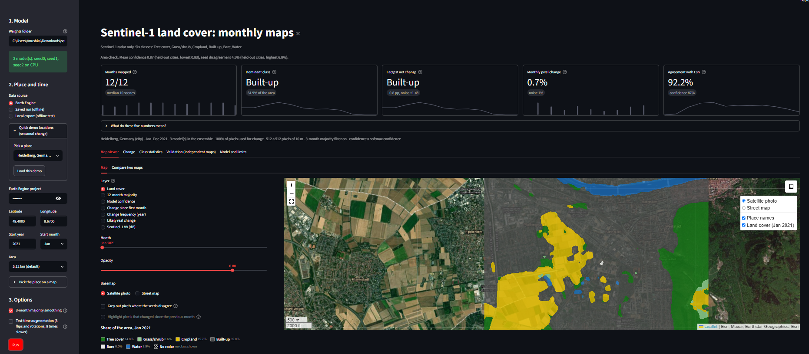

# SAR LULC: land cover maps from Sentinel-1 radar alone

A U-Net that maps six land cover classes from Sentinel-1 radar only, and a Streamlit prototype that turns a latitude, longitude and
start month into twelve monthly maps with class shares and change in percentage points.
Course project, Deep Learning, SRH Hochschule Heidelberg, MSc Applied Data Science and AI (solo project).

The labels are annual, so the monthly maps have no ground truth. Their stability is tested on stable land instead (see Limits).

## Results

Test regions are never used for training or model selection. The shipped model is a 3-seed ensemble trained on 2021 to 2024 (21 regions) and
tested on 39 held-out regions in 2025 and 2026 (January to October), so the test is held out in space and in time.
Source of every number: `notebooks/03_train_validate_test.ipynb`, which writes `results/report_numbers.md`.

| Test | Reference map | Pooled mIoU (95% interval over regions) |
|---|---|---|
| 2025, 39 unseen regions | Dynamic World 2025 | 0.540 (0.468 to 0.615) |
| 2026, 39 unseen regions | Dynamic World 2026 | 0.562 (0.493 to 0.634) |
| 2021, 38 unseen regions (a training year, so held out in space only) | Dynamic World 2021 | 0.532 (0.446 to 0.627) |
| 2021, the 9 of those regions with independent maps | Esri 2021 (independent) | 0.668 (0.524 to 0.716) |

Per-class IoU on the 2026 test: Built-up 0.845, Tree cover 0.599, Water 0.588, Cropland 0.554, Bare 0.416, Grass/shrub 0.367.
Scores use inference with no-data neighbour months filled. That input fix was compared before and after on these test regions (2026 without it: 0.557).
Scores are over all labelled pixels. Some projects report only the pixels where two label products agree, which is easier;
that row is also in `results/report_numbers.md` (`vs Dynamic World, only where WorldCover agrees`).



## Deliverables

| Item | Where |
|---|---|
| Report | `<ADD LINK>` |
| Dataset (exported Sentinel-1 and labels) | `<ADD LINK>` |
| Model weights (3 seeds) and `ood_reference.json` | `<ADD LINK>` |
| Screen recording of the prototype on an urban area | `<ADD LINK>` |
| Notebooks with saved outputs | `notebooks/` (see below) |
| Prototype | `prototype/` |
| Result files behind every number | `results/` |

## Run it

```bash
python -m venv .venv && source .venv/bin/activate
pip install -r requirements.txt && pip install -e .
pytest -q                                    # 178 tests (on Windows, activate with .venv\Scripts\activate)
streamlit run prototype/app.py               # needs weights/ (see prototype/README.md); a new place also needs an Earth Engine project,
                                             # while runs in saved_runs/ open offline with "Saved run (offline)"
```

Five notebooks, in order. Each one is saved with its outputs and can be re-run top to bottom with no data and no GPU: slow steps sit behind a switch that is off by default, and tables and figures are rebuilt from `results/`.

| Notebook | What it does | Slow steps need |
|---|---|---|
| `notebooks/01_data_collection.ipynb` | Regions, coverage checks, export from Earth Engine | Earth Engine |
| `notebooks/02_data_preprocessing.ipynb` | Every preprocessing step, class distribution, exploring the data | The dataset |
| `notebooks/03_train_validate_test.ipynb` | Training, test runs, training curves, every table and figure of the report | Dataset and GPU |
| `notebooks/04_app.ipynb` | How to start the prototype, model check, how its numbers are calculated | Weights |
| `notebooks/05_experiments.ipynb` | Variants, the input fix, borders, what was tried and not kept | Dataset and GPU |

To repeat the full pipeline (Colab or SRH Data Lab GPU): set the switch at the top of a notebook to `True`, then run `python scripts/collect_results.py --runs <runs> <runs_multiyear> --out results` and re-run `03`.
The original notebooks, with their full logs, are in `notebooks/archive/`.
All settings are in `configs/` and all seeds are fixed. Earth Engine needs your own project ID in the environment variable `EE_PROJECT`; no ID or token is stored in the repo.

## Limits

- No monthly ground truth. I test stability on pixels both annual maps call stable: 2.61% of them change class between months in the raw maps and 1.00% after 3-month smoothing (Dynamic World itself: 6.79%; 9 regions with both annual maps, 2021).
- 2025 and 2026 are scored against Dynamic World only, a model output with its own errors.
- Weak classes: Grass/shrub, Bare, Cropland. Arid and cold regions score lowest (Sahel, Great Basin, Patagonia, Iceland, Tibet).
- Borders are soft. The CRF, graph head, test-time augmentation and the full-resolution branch are implemented; read `results/report_numbers.md` for which of them were evaluated.

## Related work and licence

Ideas taken from other projects and papers are listed in `docs/REFERENCES.md`; no GPL code is copied (the DFC2020 baseline was used as reading only). MIT licence, see `LICENSE`.

---

# Pipeline details

## Data plan

| Role | Source |
|---|---|
| Model input | Sentinel-1 GRD from Earth Engine (`COPERNICUS/S1_GRD`), IW, VV and VH, monthly median, one orbit direction per region |
| Training labels | Dynamic World monthly composites (`GOOGLE/DYNAMICWORLD/V1`) |
| Independent validation | ESA WorldCover 2021, plus CORINE and Urban Atlas for the German cities |
| Sentinel-2 | Visual checks of labels only, never a model input |

Earth Engine's Sentinel-1 data has thermal noise removal, radiometric
calibration and terrain correction, converted to dB. It does not include
radiometric terrain flattening or speckle filtering. Planetary Computer's
`sentinel-1-rtc` is the fallback (`scripts/check_coverage.py`).

## Setup

```bash
python -m venv .venv && source .venv/bin/activate
pip install -r requirements.txt
pip install -e .
pytest
```

### Earth Engine account

You need a free noncommercial Earth Engine project (Community tier):
create a Google Cloud project, enable the Earth Engine API, register it as
noncommercial at https://console.cloud.google.com/earth-engine and complete
the verification. Do not hard-code the project ID. Set it as an environment
variable (`EE_PROJECT`) or a Colab secret.

## Step 1: compare candidate years

In a Colab notebook:

```python
import ee
ee.Authenticate()
ee.Initialize(project="YOUR_PROJECT_ID")
```

Upload and unzip this repo in Colab, then:

```python
%cd sar-lulc
%run scripts/ee_year_stats.py --project YOUR_PROJECT_ID
```

It writes `reports/ee_year_stats.csv` and prints, per year: Sentinel-1
acquisitions per month, and how much of each region has a Dynamic World label.
Defaults to 2021 and 2024; use `--years 2021 2024 2025` to add more, and
`--regions heidelberg munich` to limit regions.

## Step 2: export the dataset

```python
%run scripts/export_dataset.py --dry-run
%run scripts/export_dataset.py --project YOUR_PROJECT_ID --regions heidelberg --months 7   # smoke test
%run scripts/export_dataset.py --project YOUR_PROJECT_ID                                   # everything, resumable
!python scripts/qa_overlay.py data/raw/heidelberg/2021-07.npz
```

Each region has one 2400 x 2400 px UTM grid (10 m). Sentinel-1 and Dynamic World
come from a single Earth Engine request per tile, so they share the grid. The
script checks Earth Engine's pixel positions against our grid before downloading.
Output: `data/raw/<region>/<year>-<month>.npz`.

### Optional composite settings

`export_dataset.py --angle-mask 31 45` masks swath edges by incidence angle;
`--composite mean_linear` averages in linear power instead of taking the median in dB.
Settings are stored per file and the script refuses to mix recipes in one folder.
Defaults reproduce the files already exported.

### Independent reference maps

```python
%run scripts/export_reference.py --project YOUR_PROJECT_ID --out /content/drive/MyDrive/sar-lulc/raw
```
Writes `reference.npz` per region (WorldCover 2021, Esri LULC 2021). Validation only.

### Rural class-focus tiles

`configs/regions.yaml` has 15 small (10.24 km) rural tiles after the cities, for classes the
cities lack (cropland, trees, bare, grass/shrub, water). Check Sentinel-1 and Dynamic World
coverage first, and export only tiles that pass:

```python
%run scripts/ee_year_stats.py --project YOUR_PROJECT_ID --years 2021 --regions poltava hungarian_plain beauce north_china_plain black_forest sweden_taiga appalachians sahara_algeria atacama western_desert dehesa_spain crete great_basin finnish_lakeland lake_balaton
```

After export, check the class shares per tile. If a tile is not dominated by its target class, swap it.

## Step 3: train and evaluate

`notebooks/03_train_validate_test.ipynb` holds these runs; the commands behind it:

```
python scripts/train_all.py --data data/raw --out runs                     # V0-V8, 3 seeds, resumable
python scripts/evaluate.py --data data/raw --runs runs --variant V3_window3_conf50
```

Variants (`configs/experiments.yaml`): V0 scratch U-Net ResNet-34, V1 ImageNet encoder, V2 3-month window,
V3 V2 plus Dynamic World confidence cutoff (50), V4 V3 plus seasonal coherence (needs `export_coherence.py` and the
professor's OK that coherence counts as Sentinel-1). V2-V8 use the encoder weights of whichever of V0/V1 wins on validation.

Added after the first results, all measured against V2 on validation only (the spread between seeds is about 0.01 to 0.03 mIoU, so smaller gaps are noise):
V5 five yearly statistic channels (VV min/max, VH std, VH 2nd-high minus 2nd-low, share of months VV < -18 dB; order independent),
V6 class-weight power 0.75 plus Lovasz loss, V7 speckle augmentation (multiplicative Gamma noise in dB, p 0.5, 10 looks),
V8 all three. `--exclude pampas nsw_pasture kenya_savanna mongolia_steppe arabia_desert` trains on the old regions, so the new
tiles are a separate step: compare V2 with and without them, never V5-V8 on new data against the old V2.

V9 regularisation bundle (dB shift 1.5, month dropout 0.15, window jitter 64 px, label smoothing 0.1, weight decay 0.05),
V10 label agreement filter (a training label is kept only where WorldCover agrees; needs `export_reference.py` for the train regions, and
WorldCover stops being an independent check for that model). Validation decides; nothing is stacked on V2 without a result.

New training tiles (southern hemisphere, steppe, desert;) are in `regions.yaml`. Run
`ee_year_stats.py` on them before exporting. Climate groups (`climate_groups` in `regions.yaml`) are my own coarse assignment.
`evaluate.py` also writes `per_climate.csv` and `ood_reference.json` (copy it into `weights/` for the prototype's area warning;
it prints the rank correlation between confidence and mIoU, which says whether the warning is worth anything).
Selection is on validation mIoU of EMA weights only. Test cities are never used for any choice.

`evaluate.py` reports, against Dynamic World, WorldCover, Esri and the WorldCover/Esri agreement pixels: OA, mIoU, per-class IoU and F1,
bootstrap intervals over cities, and the false-change test (change reported on pixels both annual maps call stable,
raw vs 3-month majority vs Dynamic World itself, plus the spread across seeds). Out-of-year: export test cities with
`--year 2024` and pass `--year 2024 --tag _2024`.

For the label year it also writes the `tolerant` row (a prediction counts if it matches Dynamic World, WorldCover or Esri, so it flatters any
model: report it next to `dw`, never instead) and `map_agreement.csv` (how often the other maps agree with Dynamic World, per class).

At inference, a no-data neighbour month in the window takes the value of the next month towards the centre, as the year's ends already do.
A month that has not happened yet therefore no longer reaches the model as a blank input. Training is unchanged. `--no-fill-gaps` restores the
old input for a before/after comparison. Yearly statistics of a partial year still use only the months that exist.

## Step 4: prototype

The app shows the class map over a satellite photo (opacity slider, street-map option), lets you pick the place by clicking a map,
and shows the class of a clicked pixel in all 12 months. It also has a stacked area chart of the class shares, a first-versus-last
change map, and an independent-map table that includes the Dynamic World ceiling, a majority-class baseline, the share of the area
where both references agree, and a confusion matrix against Esri. Class colours follow the ESA WorldCover legend. The basemap needs
internet and `folium`, `streamlit-folium`, `plotly`; without them the app falls back to plain maps.

`streamlit run prototype/app.py` (see `prototype/README.md`). Copy the chosen seed folders (`best.pt`, `model_card.json`) into `weights/`, plus `ood_reference.json` from `runs/eval_<variant>/` for the area warning.

Not done: the Planetary Computer terrain-corrected comparison.
Deliberately not built: two-pass noise-floor estimate, per-scene standardisation, 50 m resolution, single-relative-orbit option, extra training years (only if the model overfits).

## Design decisions

- Imagery year and label year must match. The first models use 2021, which is also the year of WorldCover and Esri. The shipped model trains on 2021 to 2024 and is tested on 2025 and 2026.
- Splits are by city, never by patch. Boxes in different splits may not overlap.
- Monthly change is computed on the pixels valid in all 12 months, so missing
  data cannot show up as land-use change (see `src/lulc/stats.py`).
- Flooded vegetation and snow/ice are ignored for now (see `src/lulc/classes.py`).
